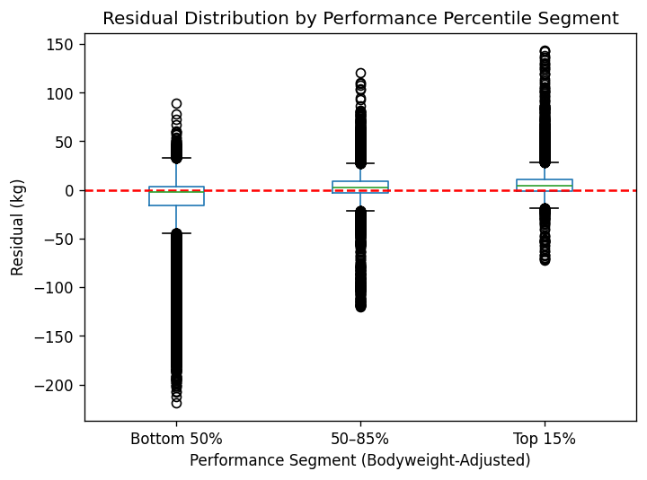

# USA Olympic Weightlifting Data - Scrape and Performance Analysis

**Live site: [olybound.com](https://olybound.com)** — look up any USAW lifter's competition history and get a prediction for their next meet.

## Overview

This project builds an end-to-end system that:

1. Scrapes all competition results from the USAW athlete portal using Playwright
2. Stores the data in a CSV file with deduplication logic
3. Cleans the data and engineers 24 leak-free features per competition entry to capture athlete trajectory, lift consistency, and competition history
4. Models athlete performance using Linear Regression, Random Forest, XGBoost, LightGBM, and CatBoost (plus a tuned-model ensemble, and LightGBM quantile models for prediction intervals)
5. Evaluates each model through segmented analysis broken down by performance percentile within weight class to determine any imbalances
6. Rebuilds the cleaned data automatically with GitHub Actions and loads it into a Supabase (Postgres) database
7. Serves it all on a public website, [OlyBound](https://olybound.com): athlete search, competition history graphs, and next-meet predictions with confidence bands

## Data Collection — `scraper/meet_scraper.py`

### Implementation
This scraper uses Playwright to automate a headless Chromium browser, log into the USAW athlete portal, then navigates to every meet result page across all specified dates.

It:
- Handles USAW's multi-factor authentication, awaiting the code on the terminal (or, with `--code-file`, from a file, for unattended runs)
- Scrapes a rolling window of the last 3 months on each run, so late-posted results are still picked up
- Paginates through both meet listings and per-meet athlete result tables
- Scrapes 14 fields per row: meet name, date, athlete name, bodyweight, all six lift attempts, best snatch, best C&J, total, and weight class
- Deduplicates on `(Meet, Date, Name, Bodyweight)` before appending new rows to the CSV
- Wraps the full run in a retry loop (up to 5 retries before failure) to handle any network flakiness

### Tech stack
`playwright`, `pandas`

## About the Data
All data is sourced from USA Weightlifting's result portal, which tracks every USAW sanctioned competition result since 2012.

As of November 2026:
- Total entries: 329,914 (including 20,895 bomb-outs)
- Athletes: ~68,000 (by name)
- Meets: 9,383, from January 2012 to November 2026
- Peak competition year: 2019, with 29,514 entries
- Fields: Meet name, date, athlete name, bodyweight, snatch attempts (3), clean & jerk attempts (3), best snatch, best C&J, total, weight category, gender, age group

Note: Athletes are only able to be identified by name in this current scraping format, as it contains no unique IDs. Thus, athletes with identical names are grouped together, which is a known limitation. This should not affect general trends found by models.

## Pipeline and Analysis

The exploration started in `EDA/EDA.ipynb`; the cleaning, feature engineering and modeling have since been moved into their own scripts so they can run automatically.

### Data Cleaning — `transform/meet_clean.py`

- Removes physiologically impossible outliers (e.g. totals > 5.5 x bodyweight)
- Corrected a known data entry error for one athlete by cross-referencing surrounding meets
- Converted missed lifts (sometimes stored as negatives or zeroes in source data) to `NaN` while preserving miss flags, in case they are useful in modeling
- Bomb-outs (Total = 0) are kept in the cleaned data and flagged with a `bombed_out` column, but excluded from model training and from every performance-history feature — a bomb-out is a different kind of event rather than a weak performance, and would badly skew predictions

### Feature Engineering — `transform/feature_engineering.py`

24 features engineered per competition entry, all using only data available before the current meet to prevent data leakage:

| Category | Features |
|---|---|
| Athlete | Bodyweight, gender |
| Lift consistency | The athlete's historical miss rate for each of the six attempts |
| Historical bests | Best snatch to date, best C&J to date, best total to date, last comp total, days since best total |
| Trajectory | 3-comp rolling trend (slope), acceleration of improvement, improvement streak |
| Lift balance | Snatch-to-C&J ratio, per-lift improvement rates over last 3 comps |
| Competition history | Number of competitions, days since last comp, comp frequency (last 180 days), average days between comps, comp timing deviation |

### Visualizations
- Total vs. bodyweight scatterplot by gender
- Bodyweight and total distributions by gender
- 31-feature correlation heatmap
- Competition entries by year
- Bodyweight vs. total with 50th and 85th percentile curves overlaid by weight class

### Segmented Analysis
Athletes are separated into current (2025) IWF weight categories, then segmented into performance percentiles within their class (non-bomb-out entries, September 2026 data)

| Segment | Size |
|---|---|
| Low (<50th percentile) | 146,373 entries |
| Mid (50th–85th) | 102,699 entries |
| High (85th–100th) | 43,723 entries |

11,472 entries have no percentile: almost all are youth lifters lighter than the lightest senior class (median bodyweight 36.6kg), plus 115 with no recorded gender.

A utility function in the notebook, `get_performance_percentile(bodyweight, total, gender)`, calculates any lifter's percentile rank relative to the full historical dataset within their weight class.

### Models — `models/train.py`, `models/evaluate.py`
Five regression models (plus a tuned-model ensemble) trained on pre-2024 data, evaluated on 2024+ data (57,714 test entries, bomb-outs excluded):
 
| Model | MAE (kg) | RMSE (kg) | R² |
|---|---|---|---|
| Linear Regression | 16.67 | 24.15 | 0.853 |
| Random Forest | 10.55 | 17.78 | 0.920 |
| XGBoost (baseline) | 10.31 | 17.49 | 0.923 |
| LightGBM (baseline) | 10.37 | 17.54 | 0.923 |
| CatBoost (baseline) | 10.77 | 17.83 | 0.920 |
| XGBoost (tuned) | 10.21 | 17.42 | 0.924 |
| LightGBM (tuned) | 10.21 | 17.42 | 0.924 |
| CatBoost (tuned) | 10.34 | 17.48 | 0.923 |
| **Ensemble (tuned XGBoost + LightGBM + CatBoost)** | **10.18** | **17.36** | **0.924** |

XGBoost, LightGBM, and CatBoost were each tuned with `RandomizedSearchCV` (5-fold cross-validation) across depth, learning rate, estimator count, and model-specific parameters. Averaging the three tuned models gives only a small gain (10.18kg vs 10.21kg for the best single model) — they're highly correlated, so ensembling has limited room to help. Linear Regression already explains 85% of the variance, but the tree models cut its error by about 40%, so the remaining signal is non-linear. For context, simply guessing "same total as last meet" scores 8.16kg on returning athletes, where the tuned models reach ~7.1kg.

> **Note (2026-09-30):** this table was re-run after two pipeline changes: a leakage fix (the current meet's own missed-attempt flags were removed from the features, since they're only known after the meet — worth roughly 0.26kg of MAE) and bomb-outs being kept in the data but excluded from training/evaluation. The test set is also larger than in earlier versions (new meets scraped since), so these figures aren't directly comparable to older ones. The Neural Network row was removed — it was dropped from the project (see `docs/findings.md`).

#### Prediction intervals

The website's predictions come from four LightGBM quantile models (25th, 50th, 75th and 99th percentile), trained with pinball loss. On 2024+ meets from returning athletes, 25.8 / 50.4 / 75.4 / 98.8% of actual totals fell below each predicted quantile (targets 25 / 50 / 75 / 99), so the bands are well calibrated.

#### Key Finding

Segmented evaluation (tuned XGBoost, by performance percentile within weight class) shows error is highest in the bottom half (MAE 11.58kg) and roughly flat across the 50th–85th (9.04kg) and top 15th (9.26kg) percentiles. Athlete history matters far more than segment: returning athletes are predicted to ~7.1kg MAE versus ~27.8kg for first-time competitors (15% of test entries), who have no prior meet to go on. Note that performance percentile is computed from the actual Total, so these segments are selected on the outcome and the gap partly reflects that. XGBoost, LightGBM, and the ensemble are effectively tied, so no single model is clearly best.

## Overall Key Findings

- **Last comp total** was the strongest predictor of current total (correlation: 0.98)
- **Tree-based models clearly outperformed Linear Regression** (~10.2kg vs 16.7kg MAE) — tuned XGBoost and LightGBM tie for best single model at 10.21kg (R² 0.924), with the three-model ensemble just ahead at 10.18kg
- **Prediction accuracy improves with competition history** — athletes with more meets were significantly easier to predict than first-time competitors, confirming that feature engineering compounds with experience (~7.1kg MAE for returning athletes vs ~27.8kg for first-time competitors)
- **Miss rates differ meaningfully by attempt** — first-attempt clean and jerk misses were rarest (10.3%), third-attempt clean and jerk misses most common (43.9%), consistent with competitive attempt selection strategy
- **Elite athletes miss more** — top 15th percentile athletes missed at 29.6% (Snatch) and 32.2% (Clean&Jerk) vs 25.7% and 24.0% (Snatch, Clean&Jerk respectively) for bottom 50th percentile

## Error Analysis
 
**Residuals by Performance Segment (Tuned XGBoost)**
 

 
- Error is highest in the bottom 50% (MAE 11.58kg vs ~9kg for the upper segments), and that segment also has a long tail of large negative residuals (actual total far below the prediction)
- Lower percentile athletes show wider residual spread, consistent with sparser feature histories and more variable performance

## Limitations

- Athletes are identified by name only — no unique athlete ID exists in the source data, so athletes with identical names are grouped together
- Exact age is not available from meet-level scraping, only the age group
- No access to training data, injury history, or competition strategy
- Feature engineering is biased toward athletes with longer competition histories — newer athletes have sparse or null values for trajectory features
- Bomb-outs (athletes who totaled zero) are kept and shown on the site, but not modeled — predictions assume the athlete doesn't bomb out
- Some weight classes are better represented than others, which may affect percentile accuracy in smaller classes

## Website — [OlyBound](https://olybound.com)

A public, read-only site built on the pipeline above.

- **Athlete search** with as-you-type suggestions
- **Home page**: the top 10 men and women by Q-points (past year or all time), a chart of how Q-points are spread for each, the fastest improvers (biggest new career-best Q-points in the past year), and charts of new athletes per year and meets per athlete
- **Athlete pages**: snatch, clean & jerk or total over time (bomb-outs shown) and a full results table; compare up to two other athletes on the same graph, each in their own colour and marker shape
- **Next-meet predictions**: pick a date (up to 12 months ahead) for each athlete on the graph, and it shows the predicted median total with bands from the 1st to the 99th percentile, mirrored around the median and starting from the athlete's latest meet (made at their last recorded bodyweight)

### Architecture

| Layer | Details |
|---|---|
| Data refresh | Scraper run locally (USAW's 2FA can't be automated); pushing new data triggers a GitHub Actions workflow that cleans it, engineers features and reloads the database (`.github/workflows/clean-data.yml`) |
| Database | Supabase Postgres, reloaded in one transaction per run, with the previous run's data kept in a backup table (`transform/load_to_supabase.py`, `transform/restore_from_backup.py`). The website uses a read-only login |
| API | FastAPI on Vercel (`app/api/`). Predictions are computed live: the 27 features are rebuilt in plain Python (no pandas or scikit-learn, to fit Vercel's size limit) and the LightGBM models, saved in their native text format, are read and run by a small pure-Python tree reader (no `lightgbm` package, which Vercel's runtime can't load). The models predict the change from the athlete's last total. `tests/check_prediction_features.py` checks the rebuild matches the pipeline's features exactly, and `tests/check_tree_model.py` checks the reader matches LightGBM's own predictions. Rankings and charts are computed in SQL at request time and cached by Vercel's CDN for an hour |
| Frontend | Next.js, React, Tailwind and Recharts on Vercel (`app/`) |

## Setup
```bash
git clone https://github.com/0Davos/USA_Olympic_Weightlifting_Scrape_and_Analysis.git
pip install -r requirements.txt
playwright install chromium
```
 
Create a `.env` file in the root directory:
```
USAW_EMAIL=your_usaw_email
USAW_PASSWORD=your_usaw_password
SUPABASE_DB_URL=your_postgres_connection_string   # only needed for the database load and the website
```
 
Run the scraper:
```bash
python scraper/meet_scraper.py
```

Rebuild the cleaned data and features, then train and evaluate the models:
```bash
python transform/meet_clean.py
python transform/feature_engineering.py
python models/train.py
python models/evaluate.py
```
 
To open the analysis notebook:
```bash
jupyter notebook
```
Then move into the EDA folder.

### Website (local)
The API needs `SUPABASE_DB_URL` set. Run the API and the frontend in two terminals:
```bash
pip install -r app/api/requirements.txt && python -m uvicorn index:app --app-dir app/api --port 8000
```
```bash
cd app && npm install && npm run dev
```
Then open http://localhost:3000 (the dev server forwards `/api/*` to port 8000).
